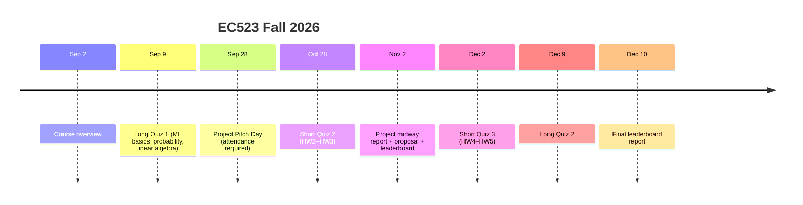

# EC523 Deep Learning — Lecture 1: Course Overview & What Is Deep Learning?

> **Instructor:** Kayhan Batmanghelich · Boston University · Fall 2026
> **Lecture date:** Wed Sep 2, 2026

---

## Table of Contents

1. [Course Logistics](#1-course-logistics)
2. [Grading & Deliverables](#2-grading--deliverables)
3. [Key Dates](#3-key-dates)
4. [What Is Deep Learning?](#4-what-is-deep-learning)
5. [A Brief History of Neural Networks](#5-a-brief-history-of-neural-networks)
6. [The Perceptron (with math)](#6-the-perceptron)
7. [Why a Single Perceptron Fails on XOR](#7-why-a-single-perceptron-fails-on-xor)
8. [The 2012 Breakthrough: ImageNet & AlexNet](#8-the-2012-breakthrough-imagenet--alexnet)
9. [What Changed? Data + Compute + Software](#9-what-changed)
10. [Applications](#10-applications)
11. [Three Key Ideas of Deep Learning](#11-three-key-ideas-of-deep-learning)
12. [Self-Check Questions](#12-self-check-questions)
13. [Glossary](#13-glossary)

---

## 1. Course Logistics

| Item | Details |
|---|---|
| Course | ENG EC523 (cross-listed CS523 A1) |
| Meeting | Mon/Wed 2:30–4:15 pm, CGS 505 |
| Instructor OH | Mon 10–11 am, outside PHO 421 |
| TA | Weicheng Dai (wd2119@bu.edu) — OH Mon 12–1 pm, PHO 442 |
| Graders | Tamerlan Baimurat, Connor Casey, Punnisa Amornsirikul |
| Communication | **Piazza** (use "Instructors" private post for staff-only questions) |
| Submissions | **Gradescope** |
| Compute | BU **SCC** (28 × NVIDIA P100, 50+ × L40s); Google Colab OK for most HW |

**Prerequisites:** calculus, linear algebra, probability & statistics, Python, basic machine learning.

**Textbooks**
- Goodfellow, Bengio, Courville — *Deep Learning*
- Zhang, Lipton, Li, Smola — *Dive into Deep Learning*
- Bishop & Bishop — *Deep Learning: Foundations and Concepts*

**Academic honesty:** work must be your own; cite any online source you consult; follow BU's GAIA (generative AI) policy.

---

## 2. Grading & Deliverables

| Component | Weight | Notes |
|---|---|---|
| Homework | 25% | HW1 (mandatory) + best 3 of HW2–HW5 |
| Quizzes / Exams | 40% | Long Quiz 1 = 10%, Long Quiz 2 = 15%, Short Quizzes = 15% |
| Project | 30% | Proposal, leaderboard, report, GitHub repo, presentation |
| Participation | 5% | Class + Piazza |

**Homework notes**
- 5 homeworks, roughly every 2 weeks, written + coding.
- HW3–HW5 coding in **PyTorch**.
- Lowest of HW2–HW5 is dropped; **HW1 cannot be dropped** (ML/math review).

**Quiz notes**
- Short quizzes: 15 min, in class, before lecture. They cover HW2–3 and HW4–5.
- No teaching on long-quiz days.

**Project notes**
- Two options: Project A and Project B, pitched on Sep 28 (mandatory, virtual).
- Teams of 3–4, formed by an optimization algorithm that respects stated preferences.
- Must run on SCC.

---

## 3. Key Dates



**Topic blocks:** ML review (Sep 2–16) → NN basics (Sep 21–30) → Training (Oct 5–13) → CNNs & architecture (Oct 14–21) → Unsupervised & generative models (Oct 26–Nov 11) → RNNs & Transformers (Nov 16–23) → Self-supervision, GNNs, explainability (Nov 30–Dec 7).

Thanksgiving recess: Nov 25–29 · Study period: Dec 11–13

---

## 4. What Is Deep Learning?

The canonical definition (LeCun, Bengio, Hinton, *Nature* 2015), paraphrased:

> Deep learning lets computational models built from **many processing layers** learn **representations of data at multiple levels of abstraction**.

Working definition from the lecture:
- Neural network architectures with **many layers**.
- They learn strong representations of **highly complex, unstructured data** — especially **images, text, and sound**.

Inspiration: biological neurons receive signals (dendrites), integrate them (cell body), and fire an output (axon → synapse). Artificial neural networks abstract this into weighted sums followed by a nonlinearity.

---

## 5. A Brief History of Neural Networks

| Year | Milestone |
|---|---|
| 1943 | **McCulloch & Pitts** — first computational neuron model: sums binary inputs, outputs 1 if above a threshold. Neurons as logic gates (AND, OR, NOT). |
| 1957–58 | **Rosenblatt's Perceptron** — single trainable neuron for binary classification, built in hardware (Mark I Perceptron). |
| 1969 | **Minsky & Papert, *Perceptrons*** — single-layer perceptrons only represent linearly separable functions (fail on **XOR**). Often (wrongly) blamed for the first AI winter. |
| 1970s–80s | Symbolic AI dominates. |
| 1986 | **Backpropagation** popularized (Rumelhart, Hinton, Williams). |
| 1988 | Backpropagation Through Time (Werbos). |
| 1989 | **CNNs** for digit recognition (LeCun et al.); **universal approximation** (Cybenko 1989, Hornik 1991). |
| 1992 | Kernel methods / SVMs rise. |
| 1997 | **LSTM** (Hochreiter & Schmidhuber). |
| mid-90s–2010 | Statistical AI / graphical models; neural nets out of fashion ("AI winter"). |
| 2006 | Hinton's Deep Belief Nets revive interest. |
| **2012** | **AlexNet** wins ImageNet — deep learning goes mainstream. |
| 2015 | ResNet (152 layers) beats human-level top-5 error on ImageNet. |

---

## 6. The Perceptron

### Model

For neuron $`k`$ with inputs $`x_1 \dots x_m`$, add a fixed input $`x_0 = +1`$ whose weight is the bias $`w_{k0} = b_k`$.

**Summing junction (induced local field):**

```math
v_k = \sum_{j=0}^{m} w_{kj} \, x_j = b_k + \sum_{j=1}^{m} w_{kj} \, x_j = \mathbf{w}_k^\top \mathbf{x}
```

**Activation (output):**

```math
y_k = \varphi(v_k)
```

For the classic perceptron, $`\varphi`$ is a hard threshold (sign) function:

```math
\varphi(v) = \begin{cases} +1 & \text{if } v \ge 0 \\ -1 & \text{if } v < 0 \end{cases}
```

The **decision boundary** $`\mathbf{w}^\top \mathbf{x} = 0`$ is a hyperplane (a straight line in 2D). Points on one side get $`+1`$, the other side $`-1`$.

### Perceptron learning rule *(standard; previewed here, covered later)*

For a misclassified example $`(\mathbf{x}, t)`$ with target $`t \in \lbrace -1, +1 \rbrace`$ and learning rate $`\eta`$:

```math
\mathbf{w} \leftarrow \mathbf{w} + \eta \, t \, \mathbf{x}
```

If the data are linearly separable, this rule is guaranteed to converge.

### 🏎️ Example: an F1 pit-wall perceptron

Decide **pit now** ($`+1`$) vs **stay out** ($`-1`$) from two features:
- $`x_1`$ = tyre age in laps (scaled: laps / 10)
- $`x_2`$ = gap to car behind in seconds (scaled: s / 10)

Choose $`w_1 = 1.0`$, $`w_2 = -1.5`$, $`b = -1.5`$.

| Situation | $`x_1`$ | $`x_2`$ | $`v = b + w_1 x_1 + w_2 x_2`$ | Decision |
|---|---|---|---|---|
| Old tyres (30 laps), big gap (25 s) | 3.0 | 2.5 | $`-1.5 + 3.0 - 3.75 = -2.25`$ | Stay out (gap protects you… for now) |
| Old tyres (30 laps), small gap (5 s) | 3.0 | 0.5 | $`-1.5 + 3.0 - 0.75 = 0.75`$ | **Pit** |
| Fresh tyres (5 laps), small gap (5 s) | 0.5 | 0.5 | $`-1.5 + 0.5 - 0.75 = -1.75`$ | Stay out |

*(The weights are illustrative, not real strategy.)* The key point: the perceptron draws **one straight line** in (tyre age, gap) space. Any strategy that needs a curved or multi-region boundary is out of reach for a single neuron — which leads directly to the XOR problem.

---

## 7. Why a Single Perceptron Fails on XOR

XOR truth table (output 1 when exactly one input is 1):

| $`x_1`$ | $`x_2`$ | XOR |
|---|---|---|
| 0 | 0 | 0 |
| 0 | 1 | 1 |
| 1 | 0 | 1 |
| 1 | 1 | 0 |

**Proof of impossibility.** Suppose a threshold unit outputs 1 iff $`w_1 x_1 + w_2 x_2 + b \ge 0`$. The four rows require:

```math
\begin{aligned}
(0,0) \to 0 &: \quad b < 0 \\
(0,1) \to 1 &: \quad w_2 + b \ge 0 \\
(1,0) \to 1 &: \quad w_1 + b \ge 0 \\
(1,1) \to 0 &: \quad w_1 + w_2 + b < 0
\end{aligned}
```

Adding the middle two: $`w_1 + w_2 + 2b \ge 0`$, so $`w_1 + w_2 + b \ge -b > 0`$, contradicting the last line. ∎

**Fix: add a hidden layer.** XOR is a composition of linearly separable functions:

```math
\text{XOR}(x_1 \, x_2) = \text{AND}\big(\text{OR}(x_1 \, x_2) \; \text{NAND}(x_1 \, x_2)\big)
```

Each of OR, NAND, AND is a single perceptron, so a 2-layer network solves XOR. This is the first taste of **compositionality** (Section 11). More generally, multi-layer perceptrons are **universal approximators** (Cybenko 1989; Hornik 1991): with enough hidden units they can approximate any continuous function on a compact domain.

---

## 8. The 2012 Breakthrough: ImageNet & AlexNet

**ImageNet** (Fei-Fei Li, Stanford): ~1,000 categories, ~1 million+ labeled images. The ILSVRC challenge became the benchmark for vision.

**AlexNet** (Krizhevsky, Sutskever, Hinton, 2012):
- ~60 M parameters, ~650 K neurons
- 5 convolutional layers (some followed by max-pooling) + 3 fully connected layers + 1000-way softmax
- Non-saturating neurons (**ReLU**), efficient **GPU** convolution, **dropout** regularization
- ILSVRC-2012 winning top-5 error ≈ **15.3%** vs **26.2%** for the runner-up

### "Revolution of Depth" — ILSVRC top-5 error

| Year | Model | Depth | Top-5 error (%) |
|---|---|---|---|
| 2010 | (shallow) | — | 28.2 |
| 2011 | (shallow) | — | 25.8 |
| 2012 | AlexNet | 8 | 16.4 |
| 2013 | ZFNet-era | 8 | 11.7 |
| 2014 | VGG | 19 | 7.3 |
| 2014 | GoogLeNet | 22 | 6.7 |
| 2015 | **ResNet** | **152** | **3.57** |

Trend: **deeper networks → lower error**. Deep learning's share of CVPR/ICCV papers grew from ~1% (2013) to ~25% (2016).

---

## 9. What Changed?

Neural networks existed since the 1940s. Why did they suddenly work around 2012?

1. **Data** — large annotated datasets (ImageNet). Jitendra Malik's quip: annotated data is the field's addiction.
2. **Compute** — GPUs (e.g., NVIDIA Tesla) made training large networks feasible.
3. **Software** — frameworks (PyTorch, TensorFlow, JAX, MXNet, CNTK, Chainer) with automatic differentiation.
4. **Algorithmic tricks** — ReLU, dropout, better initialization, and later batch norm and residual connections.

> **Big picture:** neural network + data. As the data grows, the "box" matters relatively less and the data matters more.

Silos merged: vision, speech, and language used to be separate fields with separate methods; deep learning unified them under one toolbox.

Example of scale: Google's 2012 unsupervised network watched YouTube frames for days and developed neurons that respond to cats and faces (Le et al., *Building High-level Features Using Large Scale Unsupervised Learning*).

---

## 10. Applications

| Domain | Example |
|---|---|
| Vision | Face detection in phone cameras; self-driving perception |
| Video → language | CNN per frame → mean pooling → stacked LSTMs → caption ("A boy is playing a ball") |
| Speech | Siri, Alexa; **WaveNet** raw-audio generation in Google Assistant |
| Translation | Google Translate (neural MT replaced brittle phrase-based systems) |
| Generative AI | Text-to-image diffusion (Imagen, DALL·E); text-to-video (Runway Gen-4) |
| Games / RL | AlphaGo vs Lee Sedol; Deep Q-Network playing Atari Breakout |

---

## 11. Three Key Ideas of Deep Learning

### Idea 1 — (Hierarchical) Compositionality

- A **cascade of nonlinear transformations**
- **Multiple layers of representations**

Two ways to build a complicated function from a library of simple ones $`\lbrace \sin \;\; \cos \;\; \log \;\; \exp \;\; x^3 \rbrace`$:

**(a) Linear combination** — boosting, kernel methods (shallow, "wide"):

```math
f(x) = \sum_i \alpha_i \, g_i(x)
```

**(b) Composition** — deep learning, grammar models, scattering transforms (deep, "tall"):

```math
f(x) = g_1\Big(g_2\big(\cdots g_n(x) \cdots\big)\Big)
```

Concrete example from the slide:

```math
f(x) = \log\Big(\cos\big(\exp(\sin^3 x)\big)\Big)
\quad\Longleftrightarrow\quad
x \xrightarrow{\sin} \cdot \xrightarrow{(\cdot)^3} \cdot \xrightarrow{\exp} \cdot \xrightarrow{\cos} \cdot \xrightarrow{\log} f(x)
```

**Hierarchies in different modalities**

| Modality | Hierarchy |
|---|---|
| Vision | pixels → edge → texton → motif → part → object |
| Speech | sample → spectral band → formant → motif → phone → word |
| NLP | character → word → phrase (NP/VP) → clause → sentence → story |

#### 🎸 Example: hierarchy in a classical guitar recording

| Layer | What it "detects" |
|---|---|
| Raw input | 44.1 kHz audio samples from your mic |
| Layer 1 | Spectral bands (energy at particular frequencies) |
| Layer 2 | Partials / harmonic stacks → a single plucked note (fundamental + overtones) |
| Layer 3 | Notes → intervals and chords (e.g., an E-minor shape) |
| Layer 4 | Chord sequences + rhythm → techniques (arpeggio, tremolo, rasgueado) |
| Output | "Recuerdos de la Alhambra, tremolo passage" |

No layer was hand-designed to find "tremolo" — it emerges by composing simpler detectors. In CNNs on images the same pattern appears: layer 1 learns edge/color filters, layer 2 corners and contours, layer 3 object parts, top layer object identity (Zeiler & Fergus, ECCV 2014).

#### ⌚ Analogy: a watch movement as function composition

A mechanical movement is literally a composed function: mainspring torque → gear train (each wheel multiplies the ratio) → escapement (converts continuous torque into discrete ticks) → motion works → hands. Each stage is simple; the useful behavior (telling time) exists only in the composition — just like a deep network.

### Idea 2 — End-to-End Learning

- Learn **goal-driven representations**
- Learn **to extract features**, rather than hand-crafting them

| | Feature extractor | Mid-level | Classifier |
|---|---|---|---|
| **Traditional ML** (Vision) | SIFT / HOG — *fixed* | K-means / pooling — *unsupervised* | SVM etc. — *supervised* |
| **Traditional ML** (Speech) | MFCC — *fixed* | Mixture of Gaussians — *unsupervised* | *supervised* |
| **Traditional ML** (NLP) | Parse tree / bag-of-words — *fixed* | n-grams — *unsupervised* | *supervised* |
| **Deep learning** | **Every stage is trainable** and optimized jointly for the final task | | |

"Shallow" vs deep:
- **Shallow:** hand-crafted feature extractor (fixed) → simple trainable classifier (learned).
- **Deep:** trainable transform → trainable transform → … → trainable classifier, with **learned internal representations** between modules.

Properties of the learned hierarchy:
- Each module maps its input to a **higher-level** representation.
- High-level features are **more global and more invariant**.
- Low-level features are **shared across categories** (edges help detect cars *and* faces).

Formally, if the network is $`f_\theta = f^{(L)}_{\theta_L} \circ \cdots \circ f^{(1)}_{\theta_1}`$, end-to-end learning minimizes one loss over **all** parameters jointly:

```math
\theta^\star = \arg\min_{\theta_1 \dots \theta_L} \; \frac{1}{N} \sum_{i=1}^{N} \mathcal{L}\big(f_\theta(\mathbf{x}_i) \; y_i\big)
```

(versus traditional ML, where only the classifier's parameters are optimized for the task).

### Idea 3 — Distributed Representations

- **No single neuron "encodes" everything**
- **Groups of neurons work together**; each concept is a pattern across many units, and each unit participates in many concepts.

Example (Zhou et al., *Object Detectors Emerge in Deep Scene CNNs*, ICLR 2015): a CNN trained only to classify **scenes** (bedroom, mountain) develops internal units that respond to simple elements/colors, textures, object parts, whole objects (beds, faces, windmills), and scene attributes — none of which were labeled.

#### ⚽ Example: describing a soccer player

- **Local (one-hot) code:** one neuron per player → "Messi neuron", "Modrić neuron". Can't generalize; a new player needs a new neuron.
- **Distributed code:** a vector of shared features such as [pace, dribbling, passing range, aerial ability, defensive work]. Every player is a different combination; similar players end up close together; a new player is just a new point in the same space.

With $`n`$ binary features a distributed code can represent up to $`2^n`$ distinct concepts, versus only $`n`$ for a one-hot code — an **exponential** gain in representational efficiency.

---

## 12. Self-Check Questions

1. State the perceptron's output in terms of $`\mathbf{w}`$, $`\mathbf{x}`$, $`b`$, and $`\varphi`$. What shape is its decision boundary?
2. Prove that no single threshold unit computes XOR. How many layers do you need, and why?
3. What three factors explain why deep learning took off around 2012?
4. What is the difference between building $`f`$ by *linear combination* vs *composition*? Which one is "deep"?
5. In a traditional vision pipeline, which stages are fixed, unsupervised, and supervised? What does "end-to-end" change?
6. Why are higher-layer features more invariant than lower-layer ones?
7. Why does a distributed representation generalize better than a one-hot (local) representation?
8. Roughly how did ImageNet top-5 error change from 2011 to 2015, and what architectural trend accompanied it?

<details>
<summary>Short answers</summary>

1. $`y = \varphi(\mathbf{w}^\top \mathbf{x} + b)`$; a hyperplane.
2. See Section 7 (sum of constraints contradiction). Two layers: e.g., $`\text{AND}(\text{OR} \; \text{NAND})`$.
3. Large labeled data (ImageNet), GPU compute, software frameworks (+ ReLU, dropout).
4. $`\sum_i \alpha_i g_i(x)`$ is wide/shallow; $`g_1(g_2(\cdots g_n(x)))`$ is deep.
5. SIFT/HOG fixed → K-means/pooling unsupervised → classifier supervised. End-to-end makes all stages trainable for the final loss.
6. Each layer aggregates over larger receptive fields and pools away nuisance variation (position, lighting).
7. Features are shared across concepts, so similar inputs get similar codes and $`n`$ units can represent up to $`2^n`$ patterns.
8. 25.8% → 3.57%; networks went from shallow/8 layers to 152 layers (ResNet).
</details>

---

## 13. Glossary

| Term | Meaning |
|---|---|
| **Perceptron** | Single neuron: weighted sum + threshold; linear binary classifier |
| **Bias** $`b`$ | Weight on a constant input $`x_0 = 1`$; shifts the decision boundary |
| **Activation function** $`\varphi`$ | Nonlinearity applied to the weighted sum (step, sigmoid, ReLU, …) |
| **Linearly separable** | Classes can be split by a single hyperplane |
| **MLP** | Multi-layer perceptron: stacked layers of neurons with nonlinearities |
| **Universal approximation** | An MLP with one hidden layer of enough units can approximate any continuous function on a compact set |
| **Backpropagation** | Efficient chain-rule computation of gradients through a network |
| **CNN** | Convolutional neural network; weight sharing over spatial locations |
| **LSTM** | Recurrent network with gating, for long sequences |
| **ReLU** | $`\max(0 \; v)`$ — non-saturating activation used by AlexNet |
| **Dropout** | Randomly zero out units during training to reduce overfitting |
| **Top-5 error** | Fraction of test images where the true label is not among the model's 5 best guesses |
| **End-to-end learning** | All stages of the pipeline trained jointly on the final objective |
| **Distributed representation** | Concepts encoded as patterns over many shared units |

---

*Sources: EC523 Lecture 1 slides (K. Batmanghelich), with slide credits to A. Erdem (Koç University), K. Derpanis, and B. Zhou. Cited papers: LeCun, Bengio & Hinton (Nature 2015); Krizhevsky, Sutskever & Hinton (NeurIPS 2012); He et al. (CVPR 2016); Zeiler & Fergus (ECCV 2014); Zhou et al. (ICLR 2015); Le et al. (ICML 2012).*
