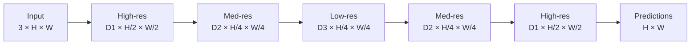
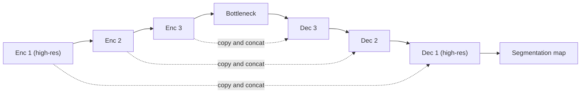
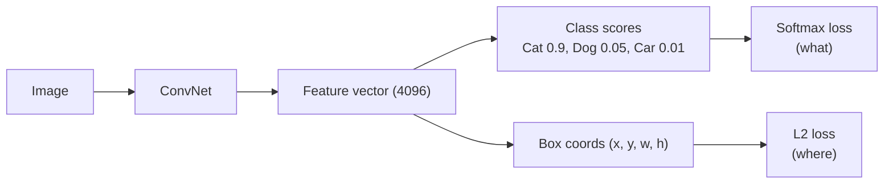
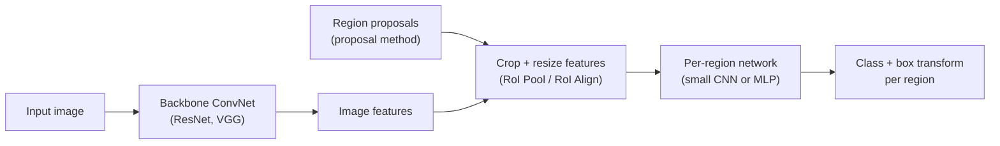
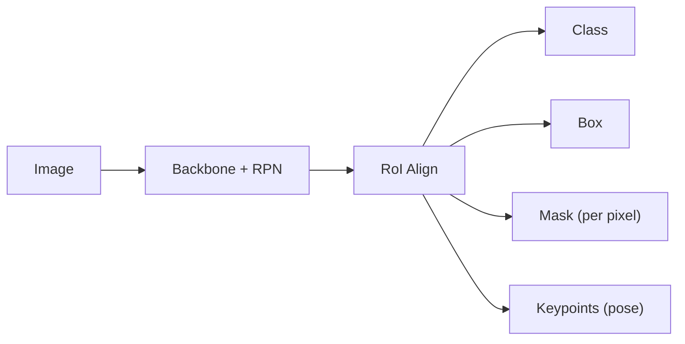

# Lecture 12: CNN III and Advanced Architectures (Computer Vision Applications)

> **EC523, Fall 2026, Oct 21**
> Slides adapted from Stanford CS231n (Spring 2019, Lecture 12).
> Topics: semantic segmentation, upsampling and transposed convolution, U-Net and skip connections, object detection (R-CNN family, RPN, RetinaNet, focal loss) and Mask R-CNN.

---

## Table of Contents

1. [Computer Vision Tasks](#1-computer-vision-tasks)
2. [Semantic Segmentation](#2-semantic-segmentation)
3. [Upsampling](#3-upsampling)
4. [Transposed Convolution](#4-transposed-convolution)
5. [Skip Connections and U-Net](#5-skip-connections-and-u-net)
6. [Object Detection](#6-object-detection)
7. [The R-CNN Family](#7-the-r-cnn-family)
8. [Region Proposal Network and Anchor Boxes](#8-region-proposal-network-rpn-and-anchor-boxes)
9. [Single-Stage Detectors: RetinaNet and Focal Loss](#9-single-stage-detectors-retinanet-and-focal-loss)
10. [Instance Segmentation: Mask R-CNN](#10-instance-segmentation-mask-r-cnn)
11. [Open Source Frameworks](#11-open-source-frameworks)
12. [Summary Cheat Sheet](#12-summary-cheat-sheet)

---

## 1. Computer Vision Tasks

| Task | Output | Example | Notes |
|---|---|---|---|
| **Classification** | One label per image | `CAT` | No spatial extent |
| **Semantic Segmentation** | A label for every pixel | `GRASS, CAT, TREE, SKY` | No objects, just pixels |
| **Object Detection** | Class + bounding box per object | `DOG, DOG, CAT` | Multiple objects |
| **Instance Segmentation** | Class + pixel mask per object | `DOG, DOG, CAT` | Multiple objects |

Up to now the course used CNNs for **classification**. This lecture moves on to the dense and multi-object tasks.

---

## 2. Semantic Segmentation

**Goal:** label each pixel in the image with a category label.

- It does **not** separate instances. It only cares about pixels. Two cows standing next to each other become one "cow" blob.

### 2.1 Idea 1: Sliding Window

1. Extract a patch around every pixel.
2. Classify the center pixel of the patch with a CNN.

**Problem:** very inefficient. Features are **not shared** between overlapping patches, so the same computation is repeated many times.

> Farabet et al., *Learning Hierarchical Features for Scene Labeling*, TPAMI 2013
> Pinheiro & Collobert, *Recurrent Convolutional Neural Networks for Scene Labeling*, ICML 2014

### 2.2 Idea 2: Fully Convolutional (same resolution everywhere)

Stack convolutional layers and predict every pixel at once:

```math
\underbrace{3 \times H \times W}_{\text{input}}
\;\xrightarrow{\text{conv layers}}\;
\underbrace{D \times H \times W}_{\text{features}}
\;\xrightarrow{\text{conv}}\;
\underbrace{C \times H \times W}_{\text{class scores}}
\;\xrightarrow{\arg\max}\;
\underbrace{H \times W}_{\text{predictions}}
```

**Two problems:**

1. **Receptive field grows only linearly** with depth, so many layers are needed before a pixel can "see" the whole image.
2. **Convolutions at full resolution are expensive.**

### 2.3 Idea 3: Fully Convolutional with Downsampling and Upsampling ✅

Put **downsampling** and **upsampling** inside the network (encoder-decoder):



| Part | How |
|---|---|
| **Downsampling** | Pooling, strided convolution |
| **Upsampling** | Unpooling, or strided **transposed convolution** |

> Long, Shelhamer & Darrell, *Fully Convolutional Networks for Semantic Segmentation*, CVPR 2015
> Noh et al., *Learning Deconvolution Network for Semantic Segmentation*, ICCV 2015

---

## 3. Upsampling

### 3.1 Nearest-Neighbour Unpooling

Replicate each element into a 2-by-2 grid:

```math
\begin{bmatrix} a & b \\ c & d \end{bmatrix}
\;\longrightarrow\;
\begin{bmatrix}
a & a & b & b \\
a & a & b & b \\
c & c & d & d \\
c & c & d & d
\end{bmatrix}
```

### 3.2 Upsampling as "Zero-Insert, then Convolve"

The same result comes from two steps:

**Step 1.** Insert zeros (put each input at a stride-2 location):

```math
\begin{bmatrix} a & b \\ c & d \end{bmatrix}
\;\longrightarrow\;
\begin{bmatrix}
a & 0 & b & 0 \\
0 & 0 & 0 & 0 \\
c & 0 & d & 0 \\
0 & 0 & 0 & 0
\end{bmatrix}
```

**Step 2.** Convolve the result with a kernel. With the **nearest-neighbour kernel**:

```math
\begin{bmatrix}
a & 0 & b & 0 \\
0 & 0 & 0 & 0 \\
c & 0 & d & 0 \\
0 & 0 & 0 & 0
\end{bmatrix}
*
\begin{bmatrix}
1 & 1 & 0 \\
1 & 1 & 0 \\
0 & 0 & 0
\end{bmatrix}
=
\begin{bmatrix}
a & a & b & b \\
a & a & b & b \\
c & c & d & d \\
c & c & d & d
\end{bmatrix}
```

Changing the kernel changes the kind of interpolation:

```math
\underbrace{\begin{bmatrix} 1 & 1 & 0 \\ 1 & 1 & 0 \\ 0 & 0 & 0 \end{bmatrix}}_{\text{nearest neighbour kernel}}
\qquad\qquad
\underbrace{\frac{1}{16}\begin{bmatrix} 1 & 2 & 1 \\ 2 & 4 & 2 \\ 1 & 2 & 1 \end{bmatrix}}_{\text{bilinear kernel}}
```

> 💡 **Key idea:** if the kernel is fixed, this is ordinary interpolation. If the kernel is **learned**, it is a **transposed convolution**.

---

## 4. Transposed Convolution

Also called: **upconvolution**, **fractionally strided convolution**, **backward strided convolution**, **half strided convolution**, and (misleadingly) "deconvolution".

### 4.1 Convolution as Matrix Multiplication (1D, stride 1)

Kernel $\vec{x} = (x, y, z)$, input $\vec{a} = (a, b, c, d)$, kernel size 3, stride 1, padding 1. Convolution can be written as a matrix product:

```math
\vec{x} * \vec{a} = X\vec{a}
```

```math
\begin{bmatrix}
x & y & z & 0 & 0 & 0 \\
0 & x & y & z & 0 & 0 \\
0 & 0 & x & y & z & 0 \\
0 & 0 & 0 & x & y & z
\end{bmatrix}
\begin{bmatrix} 0 \\ a \\ b \\ c \\ d \\ 0 \end{bmatrix}
=
\begin{bmatrix}
ay + bz \\
ax + by + cz \\
bx + cy + dz \\
cx + dy
\end{bmatrix}
```

**Transposed convolution** multiplies by the transpose of the same matrix:

```math
\vec{x} *^{T} \vec{a} = X^{T}\vec{a}
```

```math
\begin{bmatrix}
x & 0 & 0 & 0 \\
y & x & 0 & 0 \\
z & y & x & 0 \\
0 & z & y & x \\
0 & 0 & z & y \\
0 & 0 & 0 & z
\end{bmatrix}
\begin{bmatrix} a \\ b \\ c \\ d \end{bmatrix}
=
\begin{bmatrix}
ax \\
ay + bx \\
az + by + cx \\
bz + cy + dx \\
cz + dy \\
dz
\end{bmatrix}
```

✅ **When stride = 1, a transposed convolution is just a regular convolution** (with the kernel flipped and different padding rules).

### 4.2 Convolution as Matrix Multiplication (1D, stride 2)

Kernel size 3, stride 2, padding 1:

```math
\begin{bmatrix}
x & y & z & 0 & 0 & 0 \\
0 & 0 & x & y & z & 0
\end{bmatrix}
\begin{bmatrix} 0 \\ a \\ b \\ c \\ d \\ 0 \end{bmatrix}
=
\begin{bmatrix}
ay + bz \\
bx + cy + dz
\end{bmatrix}
```

The transpose **upsamples** 2 values into 6:

```math
\begin{bmatrix}
x & 0 \\
y & 0 \\
z & x \\
0 & y \\
0 & z \\
0 & 0
\end{bmatrix}
\begin{bmatrix} a \\ b \end{bmatrix}
=
\begin{bmatrix}
ax \\
ay \\
az + bx \\
by \\
bz \\
0
\end{bmatrix}
```

❗ **When stride > 1, a transposed convolution is _not_ a regular convolution.**

But it **is equivalent to upsampling (inserting zeros) and then convolving**. Inserting zeros between $a$ and $b$ and sliding the flipped kernel $(z, y, x)$ over that sequence gives the same output as $X^{T}\vec{a}$.

### 4.3 2D Picture: 3×3 Transposed Conv, Stride 2, Pad 1 (Input 2×2 → Output 4×4)

- Each **input value gives the weight** for a copy of the filter.
- The filter moves **2 pixels in the output for every 1 pixel in the input**. The stride is the ratio between movement in the output and movement in the input.
- Where the copies **overlap, the values are summed**.

Output size of a transposed convolution (per spatial dimension):

```math
W_{\text{out}} = (W_{\text{in}} - 1) \times S - 2P + K + P_{\text{out}}
```

For $W_{\text{in}} = 2$, $S = 2$, $P = 1$, $K = 3$: $(2-1) \times 2 - 2 + 3 = 3$, so an extra output padding $P_{\text{out}} = 1$ gives the $4 \times 4$ output on the slide.

Compare with a normal convolution:

```math
W_{\text{out}} = \left\lfloor \frac{W_{\text{in}} - K + 2P}{S} \right\rfloor + 1
```

### 4.4 Checkerboard Artifacts

Because the overlaps are uneven when $K$ is not divisible by $S$, transposed convolutions can create **checkerboard patterns** in generated images.
See: Odena, Dumoulin & Olah, *Deconvolution and Checkerboard Artifacts*, Distill 2016.
A common fix is **resize (nearest or bilinear) followed by a regular convolution**.

---

## 5. Skip Connections and U-Net

**Problem with a plain encoder-decoder:** fine spatial detail is lost at the low-resolution bottleneck, so boundaries come out blurry.

**Fix: skip connections.** Copy feature maps from each encoder level and concatenate them with the decoder features at the same resolution.



### U-Net (Ronneberger, Fischer & Brox, MICCAI 2015)

*U-Net: Convolutional Networks for Biomedical Image Segmentation*, one of the most cited papers in deep learning.

Building blocks (from the architecture figure):

| Arrow | Operation |
|---|---|
| ➡️ | conv 3×3, ReLU |
| ➡️ (gray) | copy and crop (skip connection) |
| ⬇️ | max pool 2×2 |
| ⬆️ | up-conv 2×2 |
| ➡️ (final) | conv 1×1 (to class scores) |

The contracting path captures **context ("what")**. The expanding path with skips recovers **localization ("where")**.

---

## 6. Object Detection

### 6.1 Impact of Deep Learning

On PASCAL VOC, mean Average Precision (mAP) plateaued around 40% (2007–2012) with hand-crafted features, then jumped to about 75%+ by 2015 with deep ConvNets.

### 6.2 General Setup

- **Input:** a single image
- **Output:** a set of detected objects. For each object predict:
  1. **Category label** (from a fixed, known set of categories)
  2. **Bounding box** (four numbers: $x$, $y$, width, height)

### 6.3 Why Is It Challenging?

- **Multiple outputs:** a variable number of objects per image
- **Multiple types of output:** "what" (category) **and** "where" (box)
- **Large images:** classification works at $224 \times 224$, but detection needs higher resolution, often about $800 \times 600$

### 6.4 Detecting a Single Object = Classification + Regression



Multitask loss:

```math
\mathcal{L} = \mathcal{L}_{\text{softmax}} + \lambda \, \mathcal{L}_{L2}
```

This works for **one** object, but not for a variable number of objects.

---

## 7. The R-CNN Family

### 7.1 Region Proposals

1. Over-segment the input image into **superpixels** (pixel groups that share similar characteristics, such as colour and texture).
2. Merge superpixels into **object proposals**, candidate boxes likely to contain an object (e.g. *Selective Search*, about 2000 per image).

### 7.2 "Slow" R-CNN

1. Extract object region proposals.
2. **Warp** each region to a canonical size (e.g. $224 \times 224$).
3. For **each proposal**, run the ConvNet to extract features.
4. Use MLP features to **classify** the region and **refine the bounding box** (box regression).

❌ A forward pass for **each** proposal → **slow processing**.

### 7.3 Fast R-CNN

**Key change:** run the backbone **once** on the whole image, then crop per-region features from the feature map.



- The heavy computation (backbone) is shared.
- Only a **smaller per-region network** runs on each region.

❌ Now the **hand-crafted region proposals are the performance bottleneck**.

### 7.4 Faster R-CNN = Fast R-CNN + Region Proposal Network

Replace the hand-crafted proposal method with a **learned Region Proposal Network (RPN)** that reads the same backbone features.

> Ren, He, Girshick & Sun, *Faster R-CNN: Towards Real-Time Object Detection with Region Proposal Networks*, NeurIPS 2015

### 7.5 Test-Time Speed

| Model | Seconds per image |
|---|---|
| R-CNN | 49 |
| SPP-Net | 4.3 |
| Fast R-CNN | 2.3 |
| **Faster R-CNN** | **0.2** |

---

## 8. Region Proposal Network (RPN) and Anchor Boxes

### 8.1 Anchor Boxes

- At each location of the feature map, place a set of **anchor boxes** of fixed sizes and aspect ratios, centred on that location.
- The **network predicts which anchors are valid proposals**, and how to adjust them.

### 8.2 How the RPN Works

Example: input image $3 \times 640 \times 480$ → backbone CNN → image features $512 \times 5 \times 6$.

1. Run the backbone CNN to get features **aligned to the input image**. Each feature corresponds to a point in the input.
2. With a conv layer, predict an **object vs. not-object** score for every anchor.
3. Also predict an **anchor transform** (4 numbers: box correction) for every anchor.

With one anchor per point:

| Output | Shape |
|---|---|
| Anchor is object? | $1 \times 5 \times 6$ |
| Anchor transform | $4 \times 5 \times 6$ |

**In practice**, use $K$ anchors per point with different sizes and scales (here $K = 6$):

| Output | Shape |
|---|---|
| Anchor is object? | $K \times 5 \times 6$ |
| Anchor transform | $4K \times 5 \times 6$ |

### 8.3 Two-Stage Detectors

Faster R-CNN is a **two-stage detector**:

1. **Stage 1 (once per image):** backbone + RPN → proposals
2. **Stage 2 (once per region):** crop features → per-region network → class scores + final box refinement

---

## 9. Single-Stage Detectors: RetinaNet and Focal Loss

### 9.1 RetinaNet

Similar to the RPN, but **instead of classifying anchors as object / no object, it directly predicts the object category** (among $C$ categories) **or background**. No second stage.

| Output | Shape |
|---|---|
| Class scores per anchor (C classes + background) | $K(C+1) \times 5 \times 6$ (written as $2K \cdot (C+1)$ on the slide) |
| Anchor transform | $4K \times 5 \times 6$ |

**Problem: class imbalance.** There are far more background anchors than object anchors. The many easy negatives swamp the loss.

**Solution:** a new loss function, the **Focal Loss**.

### 9.2 Focal Loss

Binary cross-entropy:

```math
\mathrm{CE}(p, y) =
\begin{cases}
-\log(p) & \text{if } y = 1 \\
-\log(1 - p) & \text{otherwise}
\end{cases}
```

Define the probability of the ground-truth class:

```math
p_t =
\begin{cases}
p & \text{if } y = 1 \\
1 - p & \text{otherwise}
\end{cases}
\qquad\Rightarrow\qquad
\mathrm{CE}(p_t) = -\log(p_t)
```

Focal loss adds a modulating factor:

```math
\mathrm{FL}(p_t) = -(1 - p_t)^{\gamma} \log(p_t)
```

- $\gamma = 0$ gives ordinary cross-entropy.
- With $\gamma > 0$ (the paper uses $\gamma = 2$), **well-classified examples** ($p_t \to 1$) get loss close to zero, so training focuses on the **hard** examples.
- Example: with $\gamma = 2$ and $p_t = 0.9$, the factor $(1 - 0.9)^2 = 0.01$, so the loss is 100 times smaller than CE.

> 🏎️ **Intuition:** think of an F1 race engineer reviewing telemetry from every corner of every lap. Most corners are driven perfectly (easy negatives). Plain CE asks the engineer to spend time on each one equally. Focal loss tells them to skip the corners the driver already nails and spend the debrief on the two corners where time is being lost.

> Lin, Goyal, Girshick, He & Dollár, *Focal Loss for Dense Object Detection*, ICCV 2017

### 9.3 RetinaNet in Practice

RetinaNet also uses a **Feature Pyramid Network (FPN)** to handle objects at multiple scales:

- (a) ResNet backbone →
- (b) feature pyramid (top-down pathway + lateral connections) →
- (c) class subnet (top) and (d) box subnet (bottom), applied at every pyramid level.

### 9.4 Other Single-Stage Detectors (further reading)

- **SSD**: Single Shot MultiBox Detector
- **CornerNet**: detecting objects as paired keypoints
- **ExtremeNet**: bottom-up detection by grouping extreme and center points
- **CenterNet**: Objects as Points

---

## 10. Instance Segmentation: Mask R-CNN

> He, Gkioxari, Dollár & Girshick, *Mask R-CNN*, ICCV 2017

- Builds on Faster R-CNN. For each region it adds a small **mask head** that predicts a per-pixel mask, alongside class and box.
- Gives very good instance segmentation results.
- **Also does pose:** by predicting keypoints per region, it does human pose estimation too.



---

## 11. Open Source Frameworks

Lots of good implementations on GitHub. **Fine-tune pre-trained models on your own dataset.**

| Framework | Models |
|---|---|
| [TensorFlow Detection API](https://github.com/tensorflow/models/tree/master/research/object_detection) | Faster R-CNN, SSD, R-FCN, Mask R-CNN |
| [Caffe2 Detectron](https://github.com/facebookresearch/Detectron) | Mask R-CNN, RetinaNet, Faster R-CNN, RPN, Fast R-CNN, R-FCN |

(Detectron has since been succeeded by [Detectron2](https://github.com/facebookresearch/detectron2) in PyTorch.)

---

## 12. Summary Cheat Sheet

| Concept | One-line takeaway |
|---|---|
| Sliding window segmentation | Correct but wasteful: no feature sharing |
| Fully convolutional net | Predicts all pixels at once; add down/upsampling for efficiency and receptive field |
| Unpooling | Fixed upsampling: zero-insert, then convolve with a fixed kernel |
| Transposed convolution | Learnable upsampling: multiply by $X^{T}$; stride 1 = normal conv, stride > 1 = upsample then conv |
| Skip connections / U-Net | Concatenate encoder features into the decoder to keep fine detail |
| R-CNN | CNN on every warped proposal: about 49 s per image |
| Fast R-CNN | Backbone once, crop features per region: about 2.3 s per image |
| Faster R-CNN | Learned RPN with anchor boxes replaces hand-crafted proposals: about 0.2 s per image |
| RPN outputs | $K \times H' \times W'$ objectness and $4K \times H' \times W'$ box transforms |
| RetinaNet | Single stage: classify anchors directly into $C + 1$ classes |
| Focal loss | $\mathrm{FL}(p_t) = -(1 - p_t)^{\gamma}\log(p_t)$ down-weights easy examples |
| Mask R-CNN | Faster R-CNN + mask head (and keypoint head for pose) |
