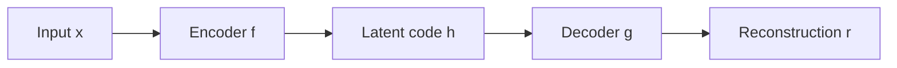
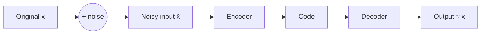

# Autoencoders: PCA Revisit, AE Basics, and Sampling

> EC523 lecture notes: Unsupervised + Generative Models block (Oct 26 – Nov 11)

**Logistics**
- HW3 due **Oct 28**
- Short Quiz 2 on **Oct 28** (15 min, covers HW2–HW3)
- Midway proposal due **Nov 2**. No extensions or late submissions.

---

## Table of Contents
1. [What is an Autoencoder?](#1-what-is-an-autoencoder)
2. [Motivation](#2-motivation)
3. [Supervised vs. Unsupervised Learning](#3-supervised-vs-unsupervised-learning)
4. [PCA Revisited: The Linear Autoencoder](#4-pca-revisited-the-linear-autoencoder)
5. [Nonlinear Autoencoders](#5-nonlinear-autoencoders)
6. [Autoencoder with Encoding Loss](#6-autoencoder-with-encoding-loss)
7. [Implementation (PyTorch)](#7-implementation-pytorch)
8. [Convolutional Autoencoder](#8-convolutional-autoencoder)
9. [PCA vs. Deep AE Reconstructions](#9-pca-vs-deep-ae-reconstructions)
10. [Training Tricks and Sparse Autoencoders](#10-training-tricks-and-sparse-autoencoders)
11. [Interpolation in Latent Space](#11-interpolation-in-latent-space)
12. [Denoising / Deblurring Autoencoders](#12-denoising--deblurring-autoencoders)
13. [Sampling](#13-sampling)
14. [Key Takeaways](#14-key-takeaways)

---

## 1. What is an Autoencoder?



An autoencoder is trained to **copy its input to its output**:

```math
h = f(x) \qquad r = g(h) = g(f(x)) \approx x
```

**Why copy input to output? Isn't that useless?**
The output itself is not the point. The hope is that the **latent representation** $h$ is useful.

**Uses of autoencoders**
- **Lower dimensionality** for another task (feature extraction, compression)
- **De-noise**, reconstruct, or manipulate data
- Train deep representations **without supervision**
- **Generate** new data (Variational Autoencoders, VAE, covered later)

> **Intuition (classical guitar recording):** Think of the encoder as a skilled transcriber who listens to a recording of a Tárrega étude and writes down a compact score (notes, dynamics, tempo). The decoder is a performer who plays from that score. If the replayed piece sounds like the original, the score has captured what matters, and the score (the latent code) is far smaller than the raw audio.

---

## 2. Motivation

### 2.1 Compression

- **OpenAI Jukebox** (openai.com/blog/jukebox): hierarchical audio autoencoder with three levels that compress raw audio by **8×**, **32×**, and **128×**. Each level has its own decoder; higher compression means coarser but still recognizable reconstruction.
- **Lossy Image Compression with Compressive Autoencoders** (Theis et al., ICLR 2017):
  - Encoder: normalize → mirror-pad → strided convs (64×5×5/2, 128×5×5/2) → residual blocks (128×3×3) → conv 96×5×5/2 → **round** (quantize) → code
  - Decoder: sub-pixel convolutions (512×3×3/2, 256×3×3/2, 12×3×3/2) with residual blocks → denormalize → clip → output
  - Rounding is not differentiable, so training uses a smooth approximation (noise / GSM entropy model).

### 2.2 Super-resolution (Lim et al., 2017, EDSR / MDSR)

×4 super-resolution compared with Bicubic, A+, SRCNN, VDSR, SRResNet. Deeper residual networks recover sharper detail (higher PSNR / SSIM).

| Model | # Blocks | Channels | # Parameters |
|---|---|---|---|
| EDSR | 32 | 256 | 43M |
| MDSR | 80 | 64 | 8M |

Example (DIV2K image 0869): Bicubic 22.66 dB / 0.8025 → EDSR+ 23.89 dB / 0.8563 → MDSR+ 23.90 dB / 0.8558.

---

## 3. Supervised vs. Unsupervised Learning

**Supervised:** we have input $X$ and target $Y$.

```math
\hat{Y} = f(X; \mathbf{W}, b) \qquad \text{minimize} \quad E_f(Y, \hat{Y})
```

**Unsupervised:** no target, so no error signal in the usual sense. Labels are expensive; unlabeled data is abundant. Why not exploit it?

**Idea:** introduce a **code** $Z$ (latent / hidden representation) and define errors in terms of how well $Z$ represents $X$.

We want the code to be a **compact representation** of the inputs:
- **low-dimensional**, and/or
- **sparse**

---

## 4. PCA Revisited: The Linear Autoencoder

### 4.1 What is PCA?

- **PC1**: direction of maximum variance of the (centered) data
- **PC2**: orthogonal to PC1, next-largest variance
- Projecting a point onto PC1 gives a **1-D code**

Given centered data $X \in \mathbb{R}^{n \times d}$ (rows are samples), the sample covariance is

```math
C = \frac{1}{n} X^{T} X
```

and the principal components are the top eigenvectors of $C$.

### 4.2 Linear encoder / decoder

- Input: $d$ dims. Latent: $r$ dims. Output: $d$ dims.
- Encoder: $x \mapsto xW$ with $W \in \mathbb{R}^{d \times r}$
- Decoder: reverses the encoder with the same $W$: $xW \mapsto (xW)W^{T}$

### 4.3 Loss function

Using squared reconstruction loss:

```math
L = \sum_{i=1}^{n} \left\lVert x_i - x_i W W^{T} \right\rVert_2^2 = \left\lVert X - X W W^{T} \right\rVert_F^2
```

- **When $r \ge d$:** trivial solution (e.g. $W = I$) that reconstructs everything exactly. Nothing useful is learned.
- **When $r < d$:** the optimum spans the same subspace as the top-$r$ principal components. The solution equals PCA **up to a rotation** (any $WQ$ with orthogonal $Q \in \mathbb{R}^{r \times r}$ gives the same loss).

### 4.4 Classic PCA examples
- Gene expression data: 3-D gene space → 2-D component space, where clusters separate.
- **Eigenfaces**: principal components of face images look like ghostly "basis faces".

### 4.5 The case $r > d$: sparsity

Can the code be **larger** than the input and still be useful? Yes, if we enforce **sparsity**:

```math
\left\lVert X - X W W^{T} \right\rVert_F^2 + \lambda \sum_{i=1}^{n} \left\lVert (XW)_i \right\rVert_1
```

- The $\ell_1$ penalty pushes most code entries to zero.
- Related to **sparse coding** (dictionary learning).

### 4.6 Sparse representations

Biological motivation: **V1 visual cortex**.
On MNIST, a 28×28 image can be written as a small combination of **codes** from a **basis set** (stroke-like atoms):

```math
x \approx \sum_{k} z_k \, \phi_k \qquad \text{with most } z_k = 0
```

e.g. a "7" ≈ 1·(stroke) + 1·(stroke) + … + 0.8·(stroke) + 0.8·(stroke).

(Ranzato, Poultney, Chopra & LeCun, NIPS 2006; Ranzato, Boureau & LeCun, NIPS 2007)

---

## 5. Nonlinear Autoencoders

### 5.1 What can go wrong?

- An MLP is a **universal approximator**.
- With enough capacity, it can simply **memorize** the data (learn the identity), which is not useful.

**Ways to force useful features**

| Strategy | Idea |
|---|---|
| **Bottleneck** | keep the code size small |
| **Noise** | denoising autoencoders |
| **Regularization** | sparse autoencoders |

### 5.2 Bottleneck (undercomplete) autoencoder

Input → (wide) → (narrower) → **Code** → (narrower) → (wide) → Output. Target = input.

"Bottleneck" code: **low-dimensional, typically dense, distributed** representation.

Design knobs:
- **Code dimension:** smaller → more compression
- **Number of layers:** deeper is better but harder to train
- **Loss function:** mean squared error (MSE) or binary cross-entropy (BCE, for inputs in $[0,1]$)

```math
\mathcal{L}_{\text{MSE}} = \lVert x - \hat{x} \rVert_2^2
\qquad
\mathcal{L}_{\text{BCE}} = -\sum_{j} \left[ x_j \log \hat{x}_j + (1 - x_j)\log(1 - \hat{x}_j) \right]
```

### 5.3 Overcomplete autoencoder

Code is **larger** than the input ($Y = X$ target, $Z$ wide).
"Overcomplete" code: **high-dimensional, distributed, sparse** representation. Needs regularization (sparsity, noise), otherwise it copies the input.

---

## 6. Autoencoder with Encoding Loss

Treat the code $Z$ as its own variable, with two "energies":

| Part | Formula | Meaning |
|---|---|---|
| Code prediction | $\hat{Z} = g_{\theta_2}(X)$ | encoder predicts the code |
| Encoding energy | $E_g(Z, \hat{Z}) = \lVert Z - \hat{Z} \rVert_2^2$ | code should match encoder output |
| Input decoding | $\hat{X} = h_{\theta_1}(Z)$ | decoder reconstructs input from code |
| Decoding energy | $E_h(X, \hat{X}) = \lVert X - \hat{X} \rVert_2^2$ | reconstruction should match input |

Total loss:

```math
\mathcal{L}(\theta_1, \theta_2) = \sum_{i=1}^{N} \underbrace{\left\lVert Z_i - g_{\theta_2}(X_i) \right\rVert_2}_{\text{encoding energy}} + \underbrace{\left\lVert X_i - h_{\theta_1}(Z_i) \right\rVert_2}_{\text{decoding energy}}
```

> Note: the slide writes the decoder as $h_{\theta_2}$ in this formula; from the diagram it should be $h_{\theta_1}$ (decoder parameters $\theta_1$, encoder parameters $\theta_2$).

**How do I get the $Z$'s?** Alternate two steps:

1. **Infer** the codes $Z$ given the current parameters:

```math
Z_i^{\star} = \arg\min_{\mathbf{z}} \left\lVert \mathbf{z} - g_{\theta_2}(X_i) \right\rVert_2
```

(in general, one minimizes the full energy over $\mathbf{z}$, including the decoding term, e.g. plus a sparsity penalty)

2. **Learn** the parameters $\theta_1$ and $\theta_2$ of encoder and decoder given the current codes $Z$ by minimizing $\mathcal{L}(\theta_1, \theta_2)$.

This is closely related to **Expectation-Maximization (EM)** in graphical models (infer latent variables ↔ update parameters).

---

## 7. Implementation (PyTorch)

Fully connected AE on MNIST: $784 \to 128 \to 64 \to 36 \to 18 \to 9 \to 18 \to 36 \to 64 \to 128 \to 784$

```python
import torch

# 28*28 ==> 9 ==> 28*28
class AE(torch.nn.Module):
    def __init__(self):
        super().__init__()
        # Encoder: 784 ==> 9
        self.encoder = torch.nn.Sequential(
            torch.nn.Linear(28 * 28, 128),
            torch.nn.ReLU(),
            torch.nn.Linear(128, 64),
            torch.nn.ReLU(),
            torch.nn.Linear(64, 36),
            torch.nn.ReLU(),
            torch.nn.Linear(36, 18),
            torch.nn.ReLU(),
            torch.nn.Linear(18, 9)
        )
        # Decoder: 9 ==> 784
        # Sigmoid outputs values in [0, 1] (pixel intensities)
        self.decoder = torch.nn.Sequential(
            torch.nn.Linear(9, 18),
            torch.nn.ReLU(),
            torch.nn.Linear(18, 36),
            torch.nn.ReLU(),
            torch.nn.Linear(36, 64),
            torch.nn.ReLU(),
            torch.nn.Linear(64, 128),
            torch.nn.ReLU(),
            torch.nn.Linear(128, 28 * 28),
            torch.nn.Sigmoid()
        )

    def forward(self, x):
        encoded = self.encoder(x)
        decoded = self.decoder(encoded)
        return decoded
```

Visualizing reconstructions:

```python
for i, item in enumerate(image):
    item = item.reshape(-1, 28, 28)   # reshape for plotting
    plt.imshow(item[0])

for i, item in enumerate(reconstructed):
    item = item.reshape(-1, 28, 28)
    plt.imshow(item[0])
```

Reconstructions of 7, 2, 1, 0, 4 are recognizable but slightly blurry.

---

## 8. Convolutional Autoencoder

| Stage | Layer | Output shape |
|---|---|---|
| Input | | 28×28×1 |
| Encoder | Conv1, stride 2 | 14×14×32 |
| | Conv2, stride 2 | 7×7×64 |
| | Conv3, stride 2 | 3×3×128 |
| | Flatten | 1152 |
| Code | FC | 10 (= $h$) |
| Decoder | FC | 1152 |
| | Reshape | 3×3×128 |
| | DeConv3, stride 2 | 7×7×64 |
| | DeConv2, stride 2 | 14×14×32 |
| | DeConv1, stride 2 | 28×28×1 |

Note $3 \times 3 \times 128 = 1152$. Transposed convolutions ("DeConv") upsample back to image size.

---

## 9. PCA vs. Deep AE Reconstructions

Comparison of $g \circ f(X)$ on MNIST for code size $d$ (Fleuret, *Deep Learning* 7.2):

> ⚠️ Notation: in Sec. 4, $d$ = input dim and $r$ = code dim. In these Fleuret slides, $d$ = **code** dim.

| Code dim $d$ | CNN autoencoder | PCA |
|---|---|---|
| 2 | Digits mostly recognizable; some confusions (4→9, 5→3) | Very blurry; almost everything looks like 9, 0, or 3 |
| 4 | Nearly all digits correct | Still blurry and ambiguous |
| 8 | Sharp and correct | Starting to be readable |
| 16 | Almost identical to originals | Readable but blurry |
| 32 | Essentially perfect | Good but noticeably smoother |

**Takeaway:** a nonlinear (deep) encoder/decoder uses each latent dimension far more efficiently than a linear projection.

---

## 10. Training Tricks and Sparse Autoencoders

### 10.1 Usual SGD questions still apply
- Regularization ($\ell_1$ or $\ell_2$) of the parameters?
- Learning rate? Learning rate decay?
- Momentum?
- Choosing hyperparameters: cross-validation?

### 10.2 Sparse autoencoder
- **Regularize the code layer** to be sparse (not just the weights):

```math
\mathcal{L} = \lVert x - g(f(x)) \rVert_2^2 + \lambda \lVert f(x) \rVert_1
```

- Works **even with large code sizes** (overcomplete).
- Histogram of code values on the test set: the standard model spreads values broadly (peak ≈ 5, tail to ≈ 30); the regularized model is sharply peaked near **0**.
- **Bases learned on layer 1** (sparse coding dictionary, 120,000 SGD iterations): localized stroke-like pieces of digits, similar to V1 receptive fields.

---

## 11. Interpolation in Latent Space

Encode two images, blend their codes linearly, then decode:

```math
\forall\, x, x' \in \mathcal{X}^2, \quad \alpha \in [0, 1]: \qquad
\xi(x, x', \alpha) = g\big( (1 - \alpha) f(x) + \alpha f(x') \big)
```

- **PCA interpolation ($d = 32$):** behaves like a pixel-wise cross-fade; intermediate frames are two digits superimposed and blurred.
- **Autoencoder interpolation ($d = 8$ and $d = 32$):** intermediate frames look more like plausible digits that **morph** (e.g. 3 → 8 → 9, 0 → 6, 7 → 2, 6 → 0).

> **Intuition (watch movements):** Interpolating in pixel space is like overlaying a photo of a manual movement on a photo of an automatic. You see two half-transparent movements. Interpolating in a good latent space is like gradually adding a rotor and winding train to the manual movement: every intermediate state still looks like a real movement.

---

## 12. Denoising / Deblurring Autoencoders

Corrupt the input, but ask the network to reconstruct the **clean** original:



```math
\tilde{x} \sim q(\tilde{x} \mid x) \qquad
\mathcal{L} = \mathbb{E}_{x}\, \mathbb{E}_{\tilde{x} \sim q(\cdot \mid x)} \left\lVert x - g(f(\tilde{x})) \right\rVert_2^2
```

Because copying $\tilde{x}$ is no longer optimal, the model must learn the **structure** of the data.

Corruption types shown:

| Corruption | Result |
|---|---|
| Additive noise (salt & pepper / Gaussian) | Clean, slightly smoothed digits |
| Masking pixels, $p = 0.5$ | Near-perfect reconstruction |
| Masking pixels, $p = 0.9$ | Mostly correct; a few wrong digits (e.g. 2→3, 5→4) and blur |
| Gaussian blur, $\sigma = 2$ | Sharp, correct reconstruction |
| Gaussian blur, $\sigma = 4$ | Still sharp and correct despite heavy blur |

> **Intuition (guitar recording):** Train on pairs of (clean studio take, same take with room hiss and string squeak added). The model learns what a guitar note "should" sound like, so it can strip noise from new recordings.

---

## 13. Sampling

### 13.1 Basics of sampling

**Gaussian** $\mathcal{N}(m, \Delta)$: draw $\varepsilon \sim \mathcal{N}(0, I)$, factor $\Delta = L L^{T}$ (Cholesky), then

```math
z = m + L \varepsilon \quad \Rightarrow \quad z \sim \mathcal{N}(m, \Delta)
```

**Multinomial / categorical** with probabilities $p_1 \ldots p_K$: draw $u \sim \mathcal{U}(0, 1)$ and pick the smallest $k$ with

```math
\sum_{j=1}^{k} p_j \ge u
```

**Mixture** $p(z) = \sum_{k} \pi_k \, p_k(z)$: first sample a component $k \sim \text{Categorical}(\pi)$, then sample $z \sim p_k$.

### 13.2 Generating with an autoencoder

1. Encode the training set and fit a Gaussian to the codes:

```math
\hat{m} = \frac{1}{N} \sum_{n=1}^{N} f(x_n)
\qquad
\hat{\Delta} = \frac{1}{N - 1} \sum_{n=1}^{N} \big(f(x_n) - \hat{m}\big)\big(f(x_n) - \hat{m}\big)^{T}
```

2. Assume $f(X) \sim \mathcal{N}(\hat{m}, \hat{\Delta})$, sample $z \sim \mathcal{N}(\hat{m}, \hat{\Delta})$.
3. Decode: $x_{\text{new}} = g(z)$.

### 13.3 Results

| Code dim $d$ | Sample quality |
|---|---|
| 8 | Many digit-like shapes, some malformed |
| 16 | More distorted strokes, fewer clear digits |
| 32 | Mostly scribbles |

**Why it gets worse with larger $d$:** the true distribution of codes is **not** Gaussian. In higher dimensions the Gaussian puts mass in regions where no training codes lie ("holes"), and the decoder has never learned what to output there.

➡️ **This motivates the Variational Autoencoder (VAE):** force the latent distribution to match a known prior so that sampling works.

---

## 14. Key Takeaways

- An autoencoder learns $x \to h \to \hat{x}$; the value is in the code $h$.
- A **linear AE with squared loss = PCA** (up to rotation) when $r < d$; trivial when $r \ge d$.
- To avoid learning the identity: **bottleneck**, **noise** (denoising AE), or **regularization** (sparse AE).
- Deep/CNN AEs reconstruct far better than PCA for the same code size.
- Latent interpolation in an AE yields more plausible intermediates than PCA.
- Denoising AEs recover clean data from heavy masking and blur.
- Sampling a plain AE by fitting a Gaussian to codes works poorly as $d$ grows → **VAE**.

---

### Credits and resources
- Slide credits: Piotr Mirowski, Arden Dertat, François Fleuret (*Deep Learning*)
- [Applied Deep Learning Part 3: Autoencoders (Arden Dertat)](https://towardsdatascience.com/applied-deep-learning-part-3-autoencoders-1c083af4d798)
- [Keras autoencoder notebook](https://github.com/ardendertat/Applied-Deep-Learning-with-Keras/blob/6bb13df482ae86d170b71293b31ae7f55145d201/notebooks/Part%203%20-%20Autoencoders.ipynb)
- [Udacity PyTorch convolutional autoencoder notebook](https://github.com/udacity/deep-learning-v2-pytorch/blob/master/autoencoder/convolutional-autoencoder/Convolutional_Autoencoder_Solution.ipynb)
