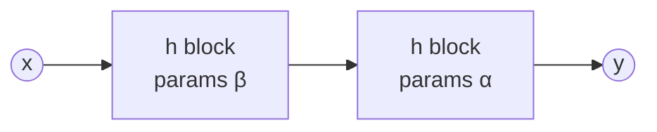
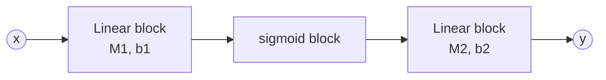

# Deep Learning — Single Layer Neural Networks

> EC523 · Lecture notes (GD vs SGD wrap-up, single-layer networks, universal approximation)

**Logistics**
- Homework 1 due **Sep 23** (Gradescope: submit both the PDF and the notebook).
- Project Pitch Day **Sep 28**: hybrid (in-person + Zoom). Attendance is mandatory and counts toward class attendance.

---

## Table of Contents
1. [Preliminary Notation](#1-preliminary-notation)
2. [GD vs SGD](#2-gd-vs-sgd)
3. [Neural Networks as Composed Blocks](#3-neural-networks-as-composed-blocks)
4. [The Typical Block and Activation Functions](#4-the-typical-block-and-activation-functions)
5. [Single Hidden-Layer Network](#5-single-hidden-layer-network)
6. [Universal Approximation](#6-universal-approximation)
7. [Proof Sketch (Sigmoid)](#7-proof-sketch-sigmoid)
8. [Universal Approximation Is Not Enough: A PyTorch Experiment](#8-universal-approximation-is-not-enough-a-pytorch-experiment)
9. [Lessons Learned](#9-lessons-learned)
10. [Intuition: An F1 Speed Trace](#10-intuition-an-f1-speed-trace)

---

## 1. Preliminary Notation

**Per-sample loss vs. total loss.** $`\ell(y, \hat{y})`$ is the loss on one sample, and $`\mathcal{L}`$ is the total loss:

```math
\mathcal{L}(\theta) = \sum_{i} \ell\big(y_i, \hat{y}(x_i; \theta)\big)
```

**Regularizers**

| Name | Also known as | Regularizer |
|---|---|---|
| $`L_2`$ regularization | Weight decay | $`r(x) = \lambda \lVert x \rVert_2^2`$ |
| $`L_1`$ regularization | Lasso | $`r(x) = \lambda \lVert x \rVert_1`$ |

**Hessian of the loss**

```math
H = \nabla_\theta^2 \mathcal{L}(\theta)
```

**Eigendecomposition of $`H`$** (symmetric, so $`U`$ is orthogonal)

```math
H = U^\top \operatorname{diag}(\lambda_1, \lambda_2, \dots) \, U
```

**Operator norm** (with $`\lambda_1`$ the eigenvalue of largest magnitude)

```math
\lVert H \rVert_{op} = \lvert \lambda_1 \rvert
```

---

## 2. GD vs SGD

Objective over $`N`$ training samples:

```math
\mathcal{L}(\theta) = \sum_{i=1}^{N} \ell\big(y_i, \hat{y}(x_i; \theta)\big)
```

### Update rules

**Gradient Descent (GD)**: uses all $`N`$ samples:

```math
\theta_{t+1} \leftarrow \theta_t - \eta \sum_{i=1}^{N} \nabla_\theta \ell\big(y_i, \hat{y}(x_i; \theta_t)\big)
```

**Stochastic Gradient Descent (SGD)**: uses a random mini-batch of $`B \ll N`$ samples:

```math
\theta_{t+1} \leftarrow \theta_t - \eta \sum_{i=1}^{B} \nabla_\theta \ell\big(y_i, \hat{y}(x_i; \theta_t)\big)
```

### Step size $`\eta`$

- **GD:** choose $`\eta = \frac{1}{M}`$. If $`M`$ is at least as large as the Hessian's largest eigenvalue ($`M \ge \lVert H \rVert_{op}`$), the loss is **guaranteed to decrease** every step.
- **SGD:**
  - ✅ **Good news:** the mini-batch gradient is an **unbiased** estimate: it has the same *expectation* as the full gradient.
  - ❌ **Bad news:** the step size should be **smaller** than for GD, because any single noisy gradient cannot be fully trusted.

### Convergence (finding a near-stationary point, non-convex setting)

After $`T`$ steps:

```math
\text{GD:} \quad \lVert \nabla \mathcal{L}_S(\theta) \rVert \le O\left(\frac{1}{\sqrt{T}}\right)
```

```math
\text{SGD:} \quad \mathbb{E}\left[\lVert \nabla \mathcal{L}_S(\theta) \rVert^2\right] \le O\left(\frac{1}{\sqrt{T}}\right) \quad \Longrightarrow \quad \mathbb{E}\left[\lVert \nabla \mathcal{L}_S(\theta) \rVert\right] \le O\left(\frac{1}{T^{1/4}}\right)
```

### Cost per step

| | Cost per step | Progress guarantee | Gradient norm after $`T`$ steps |
|---|---|---|---|
| **GD** | $`O(\lvert S \rvert)`$ | Every step makes progress | $`O(T^{-1/2})`$ |
| **SGD** | $`O(1)`$ | Some steps may go the wrong way | $`O(T^{-1/4})`$ (in expectation) |

### When is GD more efficient than SGD?

Fix a total compute budget $`N`$. GD gets $`T = N / \lvert S \rvert`$ steps, while SGD gets $`T = N`$ steps:

```math
\text{GD:} \quad O\left(\sqrt{\frac{\lvert S \rvert}{N}}\right) \qquad \text{SGD:} \quad O\left(\frac{1}{N^{1/4}}\right)
```

Setting them equal gives

```math
\sqrt{\frac{\lvert S \rvert}{N}} = \frac{1}{N^{1/4}} \quad \Longrightarrow \quad N = \lvert S \rvert^2
```

So **GD only wins once the compute budget exceeds $`\lvert S \rvert^2`$**. For large datasets that is almost never the case, which is why SGD dominates in practice.

### Implementation notes
- In practice, $`M`$ (smoothness) and $`G`$ (gradient bound) are **unknown**, so the learning rate is set by heuristics.
- Instead of sampling a random $`(x, y) \in S`$ each step, most implementations **shuffle $`S`$ and iterate in shuffled order** (one pass = one *epoch*). This tends to work better in practice, but the theory is less well understood.

---

## 3. Neural Networks as Composed Blocks

A **neural network** is a *family of models* (a hypothesis class) built by **composing functional blocks** (also called layers or modules).

```math
\text{Typical model:} \quad y \approx f(x; \theta)
```

```math
\text{Composed model:} \quad y \approx f\big(g(x; \theta_g); \theta_f\big)
```

Compositions can get complicated:

```math
y \approx k\Big(\big[\, h\big([\, f(f(x; \theta_{f_1}); \theta_{f_2}),\ f(x; \theta_{f_1}) \,]; \theta_h\big),\ x \,\big]; \theta_k\Big)
```

### Why compose?

1. **Expressivity.** Composing simple pieces builds richer functions. Starting from a quadratic

    ```math
    f(x; a, b, c) = a + b x + c x^2
    ```

    composing it with itself gives a quartic:

    ```math
    f\big(f(x; a, b, c); a', b', c'\big) = a'' + b'' x + c'' x^2 + d'' x^3 + e'' x^4
    ```

2. **Separation of concerns.** As in programming, different layers specialize in different sub-tasks.

### Open questions (and short answers)

| Question | Answer |
|---|---|
| How do we write/think about this sensibly? | Block diagrams (below) |
| How do we train the model? | SGD |
| Which functions should we compose? | More art than science; many examples this semester |
| Why bother? | It can work *really* well |

### Block diagrams

Example:

```math
y = \alpha_0 + \alpha_1 \left(\beta_0 + \beta_1 x^2\right)^2
```

Define the block $`h(z; \theta) = \theta_0 + \theta_1 z^2`$. Then $`y = h\big(h(x; \beta); \alpha\big)`$:



**Rules of the blocks**
- A block can have multiple inputs and outputs, but usually there is one (vector-valued) input and one (vector-valued) output.
- A block with a single input and single output is often called a **layer**.
- A layer that is not directly connected to the output is a **hidden layer**.

**What goes in a block?**
- Something **easy and efficient** to compute.
- Something **differentiable** (so we can train it with gradients).
- Something **expressive** enough to represent the unknown function we are trying to approximate, making up for our lack of domain knowledge.

Block diagrams are **not unique**: the same network can be drawn by grouping operations differently. Modern architectures (ResNet for images, the Transformer for sequences) have elaborate block diagrams; we will cover both later.

---

## 4. The Typical Block and Activation Functions

```math
f(x; M, b) = \sigma(M x + b)
```

| Symbol | Meaning | Shape |
|---|---|---|
| $`x`$ | input | $`\mathbb{R}^{d}`$ |
| $`M`$ | weight matrix | $`\mathbb{R}^{h \times d}`$ |
| $`b`$ | bias | $`\mathbb{R}^{h}`$ |
| $`\theta = (M, b)`$ | block parameters | |
| $`\sigma`$ | activation function | $`\mathbb{R}^h \to \mathbb{R}^h`$ |

$`\sigma`$ is **coordinate-wise** (applies the same scalar function to each coordinate), **non-linear**, and **differentiable**.

### Why must $`\sigma`$ be non-linear?

Without it, stacking layers collapses into a single linear map:

```math
M_2 (M_1 x + b_1) + b_2 = \underbrace{(M_2 M_1)}_{M'} x + \underbrace{(M_2 b_1 + b_2)}_{b'}
```

No matter how many linear layers we stack, the model can only represent affine functions.

### Sigmoid

```math
\sigma(z)[i] = \frac{\exp(z[i])}{1 + \exp(z[i])} = \frac{1}{1 + \exp(-z[i])}
```

Here $`\sigma(z)[i]`$ is the $`i`$-th coordinate of $`\sigma(z)`$. The sigmoid is an S-shaped curve squashing $`\mathbb{R}`$ into $`(0, 1)`$.

### Common activation functions

| Name | Formula |
|---|---|
| Sigmoid | $`\sigma(x) = \frac{\exp(x)}{1 + \exp(x)}`$ |
| ReLU (Rectified Linear Unit) | $`\sigma(x) = \max(0, x)`$ |
| Softplus (smooth ReLU) | $`\sigma(x) = \log\big(1 + \exp(x)\big)`$ |

- A zoo of others: [Rectifier (neural networks), Wikipedia](https://en.wikipedia.org/wiki/Rectifier_(neural_networks))
- Survey of 400 activation functions: [Kunc & Kléma, *Three Decades of Activations* (arXiv:2402.09092)](https://arxiv.org/pdf/2402.09092)
- In practice, the field has largely converged on **ReLU, GELU, SwiGLU, and GeGLU**.

---

## 5. Single Hidden-Layer Network

Two kinds of blocks: a **linear block** (no activation) and a **sigmoid block**.

```math
y = M_2 \, \sigma(M_1 x + b_1) + b_2
```



### Neuron view

Each hidden unit computes

```math
a_i = \sigma\Big(\sum_{j} M[i, j] \, x[j] + b[i]\Big)
```

and the output is a weighted sum of these units:

```math
y = \sum_i M_2[i] \, a_i
```

### Biological inspiration

| Biology | Artificial neuron |
|---|---|
| **Dendrites** receive rescaled outputs from other neurons' axons | Weights $`\times M[i, j]`$ on each input $`x[j]`$ |
| **Soma** approximately sums the dendritic inputs | Summation $`\sum_j M[i, j] \, x[j] + b[i]`$ |
| If the sum is large enough, the **axon** fires a large voltage | $`\sigma(\cdot)`$ is large if and only if the sum is large |

### Terminology
- **Neurons / units:** individual coordinates of a layer's output.
- For a scalar $`\sigma : \mathbb{R} \to \mathbb{R}`$, the vector activation $`\sigma : \mathbb{R}^h \to \mathbb{R}^h`$ applies it coordinate-wise.
- **Architecture:** the arrangement and types of layers in a model.
- **Size / width** of a layer: the dimension of its output.
- **Depth:** the number of layers stacked.

---

## 6. Universal Approximation

### Intuition (ReLU picture)

A sum of shifted, scaled ReLUs is **piecewise linear**. Each new unit adds one "kink":

```math
f(x) = \sigma(w_1 x + b_1) + \sigma(w_2 x + b_2) + \sigma(w_3 x + b_3) + \cdots
```

With enough kinks, the piecewise-linear curve can trace any continuous target arbitrarily closely.

### Theorem (sigmoid, proved in class)

For any smooth $`f : [0, 1]^d \to \mathbb{R}`$ and any $`\epsilon > 0`$, there exist a width $`h`$ and matrices $`M_1`$, $`M_2`$ (with bias) such that

```math
\big\lvert f(x) - M_2 \, \sigma(M_1 x) \big\rvert \le \epsilon \qquad \text{for all } x \in [0, 1]^d
```

**In words:** whatever the underlying function, a *sufficiently wide* single-hidden-layer network can approximate it.

<details>
<summary><b>Food for thought:</b> does it also hold on <code>[-10, 100]^d</code>?</summary>

Yes. Any box can be mapped affinely onto $`[0, 1]^d`$ via $`u = (x - a) / (c - a)`$ coordinate-wise, and that affine map is absorbed into $`M_1`$ and the bias. It holds on any **compact** domain (but not on all of $`\mathbb{R}^d`$).
</details>

<details>
<summary><b>Food for thought:</b> why not just set <code>h = 10000000000000</code>?</summary>

- **Computational cost:** the first layer alone has $`d \times h`$ parameters.
- **Overfitting:** huge capacity can memorize noise.
- **Domain knowledge** can give far more efficient architectures (e.g., CNNs for images).
</details>

<details>
<summary><b>Food for thought:</b> why does it fail for polynomial activations?</summary>

If $`\sigma`$ is a polynomial of degree $`k`$, then $`M_2 \, \sigma(M_1 x + b)`$ is a polynomial of degree at most $`k`$, no matter how wide the network is. Polynomials of bounded degree cannot approximate arbitrary functions. The theorem holds for **any non-polynomial** activation.
</details>

The sigmoid case is proved below. The ReLU case is on the homework.

---

## 7. Proof Sketch (Sigmoid)

**Plan**
1. Prove it in **1D**, for $`f : [-1, 1] \to \mathbb{R}`$.
2. Lift to **$`d`$ dimensions** using Fourier series.

### Key fact: networks can be added

Given two single-layer networks

```math
z(x) = M_2 \, \sigma(M_1 x + b_z) \qquad k(x) = W_2 \, \sigma(W_1 x + b_k)
```

stack the first-layer weights, concatenate the second-layer weights, and stack the biases:

```math
D_1 = \begin{bmatrix} M_1 \\ W_1 \end{bmatrix} \qquad D_2 = \begin{bmatrix} M_2 & W_2 \end{bmatrix} \qquad b = \begin{bmatrix} b_z \\ b_k \end{bmatrix}
```

Then

```math
z(x) + k(x) = D_2 \, \sigma(D_1 x + b)
```

The sum is **still a single-layer network**. Its width is the **sum** of the two widths ($`h_z + h_k`$, roughly doubling).

### Linear combinations preserve approximation

Suppose

```math
\big\lvert g(x) - M_{g,2} \, \sigma(M_{g,1} x + b_g) \big\rvert \le \epsilon \qquad \big\lvert h(x) - M_{h,2} \, \sigma(M_{h,1} x + b_h) \big\rvert \le \epsilon
```

and let $`k(x) = c \, g(x) + d \, h(x)`$. By the triangle inequality:

```math
\Big\lvert k(x) - \big[c \, M_{g,2} \, \sigma(M_{g,1} x + b_g) + d \, M_{h,2} \, \sigma(M_{h,1} x + b_h)\big] \Big\rvert \le \big(\lvert c \rvert + \lvert d \rvert\big) \epsilon
```

So if $`g`$ and $`h`$ can be approximated to **any** $`\epsilon`$, then so can any linear combination $`k`$. (In particular, approximating each of $`g`$ and $`h`$ within $`\epsilon / 2`$ approximates $`g + h`$ within $`\epsilon`$.)

### Strategy for 1D

1. Pick a class of **simple functions** that a network approximates well.
2. Show **any** function is a linear combination of simple functions.

> **Why not monomials $`\{x, x^2, x^3, \dots\}`$?** They give all polynomials, but some functions are never close to their Taylor expansions. We need a better building block.

### Step 1: The bump function (1D)

The ideal building block is a box: $`\approx 1`$ on $`[-\Delta, \Delta]`$ and $`\approx 0`$ outside, with transitions of width $`O(\Delta^2)`$. It can be built from **two sigmoid neurons**:

```math
\hat{B}_\Delta(x) = \sigma\left(\frac{x + \Delta}{\Delta^2}\right) - \sigma\left(\frac{x - \Delta}{\Delta^2}\right)
```

The first sigmoid steps up near $`x = -\Delta`$, the second steps up near $`x = +\Delta`$, and their difference is a plateau. $`\hat{B}_\Delta`$ satisfies:

```math
\hat{B}_\Delta(x) \in [1 - 2\epsilon, \ 1] \quad \text{for } \lvert x \rvert \le \Delta + \log(\epsilon) \Delta^2
```

```math
\hat{B}_\Delta(x) \in [0, \ 2\epsilon] \quad \text{for } \lvert x \rvert \ge \Delta - \log(\epsilon) \Delta^2
```

> Note: $`\log(\epsilon) < 0`$ for $`\epsilon < 1`$, so $`\Delta + \log(\epsilon) \Delta^2`$ is slightly **inside** $`\Delta`$, and $`\Delta - \log(\epsilon) \Delta^2`$ is slightly **outside**. The fuzzy transition zone has width $`O(\Delta^2 \lvert \log \epsilon \rvert)`$, which shrinks much faster than $`\Delta`$.

**Approximating $`f`$ with bumps.** Tile the interval with many shifted, scaled bumps of height $`f(x_k)`$ centered at $`x_k`$:

```math
f(x) \approx \sum_{k} f(x_k) \, \hat{B}_\Delta(x - x_k)
```

Making $`\Delta`$ smaller makes the staircase hug $`f`$ more closely. (Details are on the homework.)

### Putting 1D together

```math
\underbrace{\text{a single NN can represent a bump}}_{\text{2 sigmoid units}} \ + \ \underbrace{\text{any function} \approx \text{linear combination of bumps}}_{\text{staircase}} \ + \ \underbrace{\text{sums of single NNs are single NNs}}_{\text{stacking}}
```

```math
\Longrightarrow \quad \text{any 1D function can be approximated by a single-hidden-layer NN}
```

### Step 2: Extending to $`f : [-1, 1]^d \to \mathbb{R}`$

Building $`d`$-dimensional bumps directly is hard. Instead, use **sinusoids** as the simple functions:

1. Show we can approximate $`\sin(\omega \cdot x)`$ and $`\cos(\omega \cdot x)`$ for any frequency $`\omega`$.
2. Show any $`f`$ is a combination of these (Fourier).

(2D Fourier basis functions look like striped plane waves at different orientations and frequencies.)

#### $`\sin(\omega \cdot x)`$ is secretly 1D

$`\sin(\omega \cdot x)`$ only varies along the direction $`\omega`$; it is constant along every perpendicular direction (a "corrugated sheet"). Define

```math
z := \frac{\omega}{\lVert \omega \rVert_2} \cdot x \qquad s(z) := \sin\big(\lVert \omega \rVert_2 \, z\big) \qquad \Longrightarrow \qquad \sin(\omega \cdot x) = s(z)
```

#### Approximating $`\sin(\omega \cdot x)`$

1. $`s`$ is a 1D function, so by Step 1 we can approximate it to arbitrary precision on an interval:

    ```math
    s(z) \approx M_2 \, \sigma(M_1 z + b)
    ```

2. Substitute $`z = \frac{\omega^\top x}{\lVert \omega \rVert_2}`$ and absorb the projection into the first layer:

    ```math
    \sin(\omega \cdot x) \approx M_2 \, \sigma\left(\frac{M_1 \, \omega^\top}{\lVert \omega \rVert_2} \, x + b\right)
    ```

> ⚠️ **Range note.** The slides state $`z \in [-1, 1]`$. Strictly, for $`x \in [-1, 1]^d`$, Cauchy–Schwarz gives $`\lvert z \rvert \le \lVert x \rVert_2 \le \sqrt{d}`$, so $`z \in [-\sqrt{d}, \sqrt{d}]`$. The argument is unchanged: just approximate $`s`$ on $`[-\sqrt{d}, \sqrt{d}]`$ (any compact interval works by rescaling).

The same construction works for $`\cos(\omega \cdot x)`$.

#### Fourier expansion and Riemann sum

Write $`f`$ as a Fourier integral:

```math
f(x) = \int \Big( s_\omega \sin(\omega \cdot x) + c_\omega \cos(\omega \cdot x) \Big) \, d\omega
```

Approximate the integral with a Riemann sum over a grid of frequencies with spacing $`\delta`$:

```math
f(x) \approx \sum_{\omega} \delta \Big( s_\omega \sin(\omega \cdot x) + c_\omega \cos(\omega \cdot x) \Big)
```

More terms give a better approximation. Include enough to reach $`\epsilon`$ accuracy. Each term is a single-layer NN.

### Step 2 summary
1. $`\sin(\omega \cdot x)`$ and $`\cos(\omega \cdot x)`$ can each be approximated within $`O(\epsilon)`$ by a single-layer NN.
2. $`f`$ is approximated within $`O(\epsilon)`$ by a finite linear combination of these sinusoids.
3. Linear combinations of single-layer NNs are single-layer NNs, so **$`f`$ is approximated within $`O(\epsilon)`$ by a single-layer NN.** ∎

---

## 8. Universal Approximation Is Not Enough: A PyTorch Experiment

> Just because a network **can express** a function does not mean training will **find** it.

### Model

```python
import torch
from torch import nn

class SingleLayerNet(nn.Module):
    def __init__(self, layer_size):
        super(SingleLayerNet, self).__init__()
        self.Linear1 = nn.Linear(1, layer_size)
        self.activation = nn.Sigmoid()
        self.Linear2 = nn.Linear(layer_size, 1)

    def forward(self, x):
        out = self.Linear1(x)
        out = self.activation(out)
        out = self.Linear2(out)
        return out

net = SingleLayerNet(layer_size=10)
outputs = net(x_values)
```

The **target** function was itself generated by a random 10-unit network on $`x \in [-100, 100]`$: a sequence of smooth plateaus and steps.

### Training loop

```python
def train(net, num_steps=10000):
    loss_func = nn.MSELoss()  # mean squared error: (y - y_hat)^2
    losses = []               # list of floats
    optimizer = torch.optim.Adam(net.parameters())
    for t in range(num_steps):
        optimizer.zero_grad()              # reset accumulated gradients

        predictions = net(xvals)
        loss_val = loss_func(predictions, targets)

        loss_val.backward()                # compute gradients
        optimizer.step()                   # update parameters

        losses.append(loss_val.item())     # .item() extracts the Python float
    return losses
```

### Better initialization

Spread the first-layer biases widely, so the sigmoid "steps" are distributed across the whole input range $`[-100, 100]`$ instead of clustered near $`0`$:

```python
class SingleLayerNetTryTwo(nn.Module):
    def __init__(self, layer_size):
        super(SingleLayerNetTryTwo, self).__init__()
        self.Linear1 = nn.Linear(1, layer_size)

        # force the initialization of the first linear layer to have widely
        # distributed biases - similar to how the original net was made.
        with torch.no_grad():
            self.Linear1.bias *= 80

        self.activation = nn.Sigmoid()
        self.Linear2 = nn.Linear(layer_size, 1)

    def forward(self, x):
        out = self.Linear1(x)
        out = self.activation(out)
        out = self.Linear2(out)
        return out
```

### Results

| Attempt | Width | Init | Result |
|---|---|---|---|
| 1 | 10 | default | **Mediocre.** Misses the bump near $`x \approx 70`$ and the dip near $`x \approx 90`$, even though the loss has **converged**. |
| 2 | 50 | default | Somewhat better, but still smooths over sharp features. |
| 3 | 10 | wide biases | **Much better**, with the same capacity as attempt 1. |
| 4 | 50 | wide biases | **Near-perfect** fit. |

Attempt 1 is the key point. A 10-unit network *exactly* represents the target (it was generated by one), yet gradient descent converged to a poor local solution.

---

## 9. Lessons Learned

- **Capacity ≠ learnability.** A network having enough capacity to express a function does not mean training will find it.
- **Overparameterization helps optimization.** Adding capacity can make hard functions easier to learn, but watch for **overfitting**.
- **Initialization and data normalization matter a lot.**
- **Use domain knowledge.** If you know something about your data (e.g., where features occur in input space), you can help your model train.

---

## 10. Intuition: An F1 Speed Trace

Picture a telemetry plot of an F1 car's speed $`v(s)`$ versus distance $`s`$ around a lap: long flat-ish straights near top speed, sharp drops into braking zones, then corner-exit ramps back up.

- **Bump picture (sigmoid):** each sigmoid is one sharp transition, like a braking point. A pair of sigmoids makes a plateau, such as "sustained speed through the Eau Rouge–Raidillon complex between $`s_1`$ and $`s_2`$." Summing scaled plateaus rebuilds the whole lap as a staircase:

    ```math
    v(s) \approx \sum_{k} v(s_k) \, \hat{B}_\Delta(s - s_k)
    ```

  A smaller $`\Delta`$ (more units) captures finer details like a quick lift through a kink.

- **ReLU picture:** each unit adds one kink in slope: one throttle application or braking point. The trace becomes piecewise linear.

- **The initialization lesson:** if every unit's breakpoint starts clustered at one spot on the lap (default biases), gradient descent struggles to drag them out to the hairpin at the far end of the track. Spreading the biases (`bias *= 80`) is like placing one engineer at every corner from the start: each unit begins near a feature it can learn.
